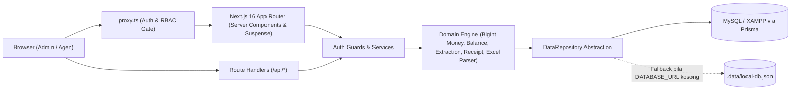

# Sistem Transaksi Manga' Travel

Aplikasi web *back-office* internal untuk mengelola dan memantau mutasi saldo (*cashflow*) agen perjalanan **Manga' Travel**, menyaring serta mencari riwayat transaksi, melihat rincian transaksi terkait dalam satu pesanan, menginput transaksi manual dengan rekalkulasi saldo otomatis, mengimpor laporan transaksi dari file Excel/CSV, serta mencetak bukti/struk transaksi pada kertas **Thermal 58mm**, **Thermal 80mm**, maupun **A4**.

> **Sumber Spesifikasi Proyek**
> - Spesifikasi fitur, aturan bisnis, & model data: [`docs/app-spec.json`](./docs/app-spec.json)
> - Spesifikasi *design system*, token warna, tipografi, & tata letak cetak: [`docs/design-spec.json`](./docs/design-spec.json)

---

## Daftar Isi

1. [Fitur Utama](#1-fitur-utama)
2. [Matriks Hak Akses (RBAC)](#2-matriks-hak-akses-rbac)
3. [Tech Stack & Arsitektur](#3-tech-stack--arsitektur)
4. [Struktur Direktori](#4-struktur-direktori)
5. [Aturan Bisnis & Invarian Finansial](#5-aturan-bisnis--invarian-finansial)
6. [Skema Database](#6-skema-database)
7. [Daftar Halaman & Endpoint API](#7-daftar-halaman--endpoint-api)
8. [Panduan Instalasi & Menjalankan Proyek](#8-panduan-instalasi--menjalankan-proyek)
9. [Format File Impor Excel / CSV](#9-format-file-impor-excel--csv)
10. [Pengujian & Pemeriksaan Kualitas](#10-pengujian--pemeriksaan-kualitas)
11. [Kontrol Keamanan](#11-kontrol-keamanan)
12. [Status Fase Pengembangan](#12-status-fase-pengembangan)

---

## 1. Fitur Utama

### Autentikasi, Sesi & Profil (`F-01`)
- **Login Berbasis Sesi Aman (`/login`)**: Menggunakan *cookie* `httpOnly` (`manga_session`) bertanda tangan HMAC-SHA256 dengan masa berlaku *sliding* **8 jam tidak aktif**, dilengkapi pembatas percobaan login (*rate limiter*) dan pencatatan audit login berhasil/gagal.
- **Profil & Ganti Password Mandiri (`/account`)**: Pengguna (`Admin` maupun `Agen`) dapat memeriksa informasi akun, kode & saldo agen yang terhubung, serta mengganti password sendiri dengan verifikasi password lama.
- **Proteksi Rute Berlapis**: Dijaga di tingkat jaringan melalui [`proxy.ts`](./proxy.ts) dan di tingkat *Data Access Layer* / *Server Components* melalui [`lib/auth/guards.ts`](./lib/auth/guards.ts) serta [`lib/auth/api-guards.ts`](./lib/auth/api-guards.ts) dengan dukungan HTTP `403` asli (`authInterrupts` + [`app/forbidden.tsx`](./app/forbidden.tsx)).

### Daftar, Filter & Pencarian Transaksi (`F-02`, `F-03`, `F-04`)
- **Dashboard Mutasi (`/transactions`)**: Menampilkan 4 kartu ringkasan KPI (*Saldo Terakhir*, *Total Kredit / Masuk*, *Total Debit / Keluar*, dan *Jumlah Transaksi* sesuai filter aktif) beserta tabel mutasi bergaya perbankan dengan angka rata kanan (`tabular-nums`).
- **Filter Multi-Kriteria (`FilterDrawer` & `FilterChips`)**:
  - Rentang tanggal + tombol pintas (*Hari Ini*, *7 Hari Terakhir*, *30 Hari Terakhir*, *Bulan Ini*).
  - Multi-pilih jenis transaksi (`Case`: `Deposit`, `Withdrawal`, `Bonus`, `Refund`, `Cashback`, `Cancel`, `Adjustment`, dll.).
  - Agen (khusus `Admin`; untuk `Agen` otomatis terkunci ke `agentId` miliknya di sisi server).
  - Arah arus kas (*Semua*, *Hanya Debit / Keluar*, *Hanya Kredit / Masuk*) & rentang nominal minimum–maksimum.
  - Seluruh status filter tersimpan di *query parameter* URL sehingga dapat dibagikan atau di-*refresh* tanpa hilang.
- **Pencarian Cepat (*Debounced* 300ms)**: Mencari berdasarkan `No. Pesanan` (contoh: `920019906`), `Kode Booking` (contoh: `1216955312`), kata kunci pada `Keterangan`, atau kode `Agen`.

### Detail Transaksi & Rekonsiliasi Grup Pesanan (`F-05`)
- **Drawer Ringkas & Halaman Detail Penuh (`/transactions/[id]`)**: Menampilkan rincian waktu (`WIB`), agen, lencana jenis transaksi, nominal debit/kredit, mutasi `Saldo Sebelum → Saldo Sesudah`, sumber data (`Manual` / `Impor Excel`), serta ekstrak `No. Pesanan` & `Kode Booking`.
- **Grup Transaksi Terkait**: Secara otomatis mengelompokkan seluruh baris mutasi yang memiliki `groupKey` (`agentId:orderNumber`) yang sama — misalnya pasangan `Withdrawal` pembelian tiket dan `Bonus` komisi agen — beserta ringkasan biaya bersihnya.

### Cetak Struk Thermal 58mm, 80mm & A4 (`F-06`)
- **Ruang Kerja Cetak (`/transactions/[id]/receipt`)**:
  - **2 Mode Struk**:
    - **Struk Individual**: Mencetak satu baris transaksi tunggal.
    - **Struk Grup (Gabungan No. Pesanan)**: Menggabungkan seluruh transaksi terkait dalam satu `No. Pesanan` secara kronologis lengkap dengan rincian *Total Potongan (Debit)*, *Total Pengembalian/Bonus (Kredit)*, dan *Biaya Bersih*.
  - **3 Ukuran Kertas Presisi CSS `@media print`**:
    - **Thermal 58mm** (area cetak efektif `48mm`, tata letak *stacked* anti-terpotong).
    - **Thermal 80mm** (area cetak efektif `72mm`, tata letak *key-value* dua kolom).
    - **A4 Formal** (`210mm`, dokumen bukti transaksi lengkap dengan tabel rincian dan kolom tanda tangan/validasi).
  - **Privasi Saldo Internal**: Secara bawaan menyembunyikan saldo akhir agen pada struk pelanggan (dapat diaktifkan per sesi cetak atau melalui Pengaturan).
  - **Audit Cetak**: Setiap klik `Cetak Struk` mencatat log audit (`receipt.print`) secara asinkron tanpa menghambat dialog cetak browser.

### Input Manual Transaksi (`F-07`)
- **Form Input Manual Khusus Admin (`/transactions/new`)**:
  - Mendukung pemilihan agen, tanggal/jam transaksi, jenis `Case` (dengan penguncian otomatis kolom Debit/Kredit pada jenis satu arah seperti `Deposit` atau `Bonus`), dan keterangan.
  - **Ekstraksi Otomatis**: Mendeteksi `No. Pesanan` dan `Kode Booking` langsung saat Admin mengetik keterangan (tetap dapat diedit manual).
  - **Kartu Pratinjau Saldo Real-Time**: Menghitung `Saldo Sebelum`, `Mutasi (+/-)`, dan `Saldo Akhir` langsung dari server sebelum disimpan, termasuk pemberitahuan rekalkulasi otomatis apabila tanggal transaksi bersifat *backdate* (mundur).

### Impor Laporan Excel / CSV 3 Langkah (`F-08`)
- **Wizard Impor Khusus Admin (`/import`)**:
  1. **Unggah File**: Mendukung `.xls`, `.xlsx`, dan `.csv` hingga `10 MB` (tersedia tombol unduh template contoh `.csv`).
  2. **Pratinjau & Validasi Baris**: Mendeteksi posisi baris *header* tabel secara dinamis (melewati judul laporan di baris atas), lalu mengklasifikasikan setiap baris ke dalam 4 status:
     - `Valid` — Siap disimpan.
     - `Peringatan Saldo` — Terdapat selisih antara kolom saldo di Excel dengan hitungan berurutan sistem.
     - `Duplikat` — Identik dengan transaksi yang sudah ada (`dedupHash`) dan otomatis dilewati agar tidak menggandakan saldo.
     - `Error` — Format tanggal/nominal tidak valid atau agen belum terdaftar (memblokir penyimpanan sampai diperbaiki atau agen didaftarkan).
  3. **Simpan Atomik & Riwayat Batch**: Menyimpan seluruh baris valid dalam satu transaksi database atomik beserta riwayat *batch* impor di bagian bawah halaman.

### Administrasi & Pengaturan Usaha (`F-10`, `F-11`)
- **Kelola Pengguna (`/admin/users`)**: Tambah/ubah akun `Admin` atau `Agen`, aktif/nonaktifkan akun (dilengkapi proteksi anti-*self-deactivation*), dan reset password.
- **Kelola Agen (`/admin/agents`)**: Tambah/ubah master agen (`JKT-37287`, `MKS-20819`, dst.) beserta saldo awal. Kode agen otomatis dikunci setelah agen memiliki riwayat transaksi demi menjaga integritas referensi.
- **Log Audit Sistem (`/admin/audit-logs`)**: Pemantau jejak audit seluruh aktivitas sensitif (login, logout, input manual, impor batch, cetak struk, manajemen user/agen, perubahan pengaturan, ganti password) lengkap dengan filter aksi dan tampilan metadata JSON.
- **Pengaturan Usaha & Kop Struk (`/settings`)**: Mengubah nama usaha, unggah logo kustom (`PNG`/`JPG`/`SVG` maks. `2 MB`), kontak *person*, alamat, catatan kaki struk, pengaturan bawaan tampil saldo/logo thermal, serta pratinjau langsung kop struk thermal.

---

## 2. Matriks Hak Akses (RBAC)

> **Aturan Keamanan Utama**: Pembatasan data untuk peran `Agen` ditegakkan sepenuhnya di **sisi server** berdasarkan `session.user.agentId`. Parameter filter `agentId` atau `agentCode` dari klien selalu diabaikan bila pengguna yang login berperan sebagai `Agen`.

| Modul / Rute | Admin | Agen | Keterangan |
| :--- | :---: | :---: | :--- |
| `/login` | Ya | Ya | Redirect ke `/transactions` bila sudah login |
| `/account` | Ya | Ya | Profil akun & ganti password mandiri |
| `/transactions` | Semua Agen | Agen Sendiri | Daftar, KPI, pencarian, & filter mutasi |
| `/transactions/[id]` | Semua Agen | Agen Sendiri | Detail transaksi & grup pesanan terkait |
| `/transactions/[id]/receipt` | Semua Agen | Agen Sendiri | Cetak struk Individual & Grup (58mm/80mm/A4) |
| `/transactions/new` | Ya | HTTP `403` | Input transaksi manual + pratinjau saldo |
| `/import` | Ya | HTTP `403` | Impor Excel/CSV & riwayat batch |
| `/admin/users` | Ya | HTTP `403` | Manajemen akun pengguna & reset password |
| `/admin/agents` | Ya | HTTP `403` | Manajemen master agen & saldo awal |
| `/admin/audit-logs` | Ya | HTTP `403` | Pemantau log audit aktivitas sistem |
| `/settings` | Ya | HTTP `403` | Profil usaha & kustomisasi kop struk |

---

## 3. Tech Stack & Arsitektur

| Lapisan | Teknologi |
| :--- | :--- |
| **Framework** | Next.js `16.4.3` (App Router, Turbopack, `cacheComponents`, `partialPrefetching`, `authInterrupts`, `proxy.ts`) |
| **Bahasa & UI** | TypeScript `5`, React `19.3` |
| **Styling & Design System** | Tailwind CSS `v4` (`@tailwindcss/turbopack`), CSS Custom Properties sesuai `design-spec.json`, font *Plus Jakarta Sans* & *JetBrains Mono* |
| **Komponen Aksesibilitas & Ikon** | Radix UI (`Dialog`, `Select`, `Popover`, `Checkbox`, `RadioGroup`, `Tooltip`) + `lucide-react` |
| **Database & ORM** | MySQL / MariaDB (XAMPP) + Prisma ORM `6.19` (dilengkapi *fallback* penyimpanan JSON lokal otomatis) |
| **Validasi & Parser** | Zod `v4`, SheetJS (`xlsx`) untuk `.xls`/`.xlsx`/`.csv` |
| **Autentikasi & Kriptografi** | Web Crypto API HMAC-SHA256 (`httpOnly` session cookie) + `bcryptjs` (cost factor `10`) |
| **Pengujian** | Vitest `5` |

### Diagram Arsitektur Aliran Data



---

## 4. Struktur Direktori

```text
mangaTravelInvoice-System/
├── app/
│   ├── 403/page.tsx                       # Rute statis HTTP 403 (memicu forbidden())
│   ├── account/page.tsx                   # Halaman profil & ganti password mandiri
│   ├── admin/
│   │   ├── page.tsx                       # Redirect indeks /admin -> /admin/users
│   │   ├── agents/page.tsx                # Halaman kelola master agen
│   │   ├── audit-logs/page.tsx            # Halaman pemantau log audit sistem
│   │   └── users/page.tsx                 # Halaman kelola pengguna
│   ├── api/                               # Internal REST Route Handlers
│   │   ├── account/password/route.ts      # POST ganti password mandiri
│   │   ├── admin/{agents,audit-logs,users}/route.ts
│   │   ├── auth/{login,logout,me}/route.ts
│   │   ├── imports/{route.ts,preview/route.ts,[batchId]/{commit,cancel}/route.ts}
│   │   ├── receipts/route.ts              # GET payload struk & POST log audit cetak
│   │   ├── settings/route.ts              # GET & PUT pengaturan profil usaha/struk
│   │   └── transactions/{route.ts,summary/route.ts,preview-balance/route.ts,[id]/route.ts}
│   ├── import/page.tsx                    # Halaman wizard impor Excel/CSV
│   ├── login/page.tsx                     # Halaman login
│   ├── settings/page.tsx                  # Halaman pengaturan usaha & kop struk
│   ├── transactions/
│   │   ├── page.tsx                       # Halaman utama daftar & filter transaksi
│   │   ├── new/page.tsx                   # Halaman input transaksi manual
│   │   └── [id]/
│   │       ├── page.tsx                   # Halaman detail transaksi penuh
│   │       └── receipt/page.tsx           # Halaman pratinjau & cetak struk 58mm/80mm/A4
│   ├── error.tsx & global-error.tsx       # Error boundary aplikasi
│   ├── forbidden.tsx                      # UI resmi HTTP 403 Access Denied
│   ├── not-found.tsx                      # UI resmi HTTP 404 Not Found
│   ├── globals.css                        # Design tokens Tailwind v4 & aturan @media print
│   └── layout.tsx                         # Root layout, font, & ToastProvider
├── components/
│   ├── account/                           # Komponen profil & ganti password
│   ├── admin/                             # Komponen CRUD user, agen, & tabel audit log
│   ├── auth/                              # Form login
│   ├── brand/                             # Logo Manga' Travel
│   ├── imports/                           # Wizard 3 langkah impor Excel/CSV
│   ├── layout/                            # AppShell (sidebar responsif, topbar, skeleton)
│   ├── receipts/                          # Workspace cetak & template struk 58mm/80mm/A4
│   ├── settings/                          # Form pengaturan usaha & live preview kop struk
│   ├── transactions/                      # Tabel mutasi, filter drawer/chips, detail drawer, form manual
│   └── ui/                                # Primitif UI (Badge, Button, Drawer, EmptyState, Modal, Skeleton, StatCard, Toast)
├── docs/
│   ├── app-spec.json                      # Spesifikasi fungsional & aturan bisnis
│   └── design-spec.json                   # Spesifikasi visual, warna, & ukuran cetak
├── lib/
│   ├── auth/                              # Session token HMAC, rate-limit, page & API guards
│   ├── data/sample-data.ts                # Data contoh terverifikasi (25 transaksi nyata)
│   ├── db/                                # Abstraksi DataRepository, Prisma MySQL store, & Local JSON store
│   ├── domain/                            # Logika murni: money (BigInt), balance, cases, extraction, excel-parser, ingest, receipt, format
│   ├── services/transaction-service.ts    # Layanan query transaksi, KPI summary, & struk
│   └── validation/transaction-query.ts    # Skema Zod query filter transaksi
├── prisma/
│   ├── schema.prisma                      # Skema database MySQL (6 model utama)
│   └── seed.ts                            # Skrip pengisian data awal (akun, agen, settings, 25 transaksi)
├── public/brand/logo.svg                  # Aset logo vektor bawaan Manga' Travel
├── tests/                                 # Suite pengujian unit & integrasi domain (Vitest)
├── .env.example                           # Contoh konfigurasi environment
├── next.config.ts                         # Konfigurasi Next.js 16 (Cache Components, Turbopack, authInterrupts)
└── proxy.ts                               # Request proxy untuk proteksi sesi, RBAC, & sliding cookie
```

---

## 5. Aturan Bisnis & Invarian Finansial

1. **Aritmetika Rupiah Berbasis Integer (`BigInt`)**:
   - Seluruh nilai uang (`debit`, `credit`, `balance`, `openingBalance`) disimpan di MySQL sebagai `BIGINT` dan diproses di TypeScript menggunakan `bigint` ([`lib/domain/money.ts`](./lib/domain/money.ts)).
   - Tidak ada penggunaan `float` atau `number` pecahan pada perhitungan uang untuk mencegah galat pembulatan.
2. **Aturan Mutasi & Rekalkulasi Saldo Berurutan**:
   - Satu baris transaksi tidak boleh memiliki `debit > 0` dan `credit > 0` secara bersamaan.
   - Rumus mutasi standar:
     $$\text{Saldo Baru} = \text{Saldo Sebelumnya} + \text{Kredit} - \text{Debit}$$
   - Apabila Admin menginput transaksi *backdate* (tanggal lebih lama dari transaksi terakhir agen tersebut), sistem otomatis menghitung ulang (`recalculate`) deretan saldo seluruh transaksi setelahnya untuk agen yang bersangkutan dalam satu transaksi database atomik ([`lib/domain/balance.ts`](./lib/domain/balance.ts)).
3. **Ekstraksi Referensi & Pengelompokan Pesanan Otomatis**:
   - Sistem mengekstrak `No. Pesanan` dengan pola `No\.?\s*Pesanan\s*[:#]?\s*([A-Za-z0-9-]+)` dan `Kode Booking` dengan pola `Kode\s*Booking\s*[:#]?\s*([A-Za-z0-9-]+)` dari kolom `Keterangan` ([`lib/domain/extraction.ts`](./lib/domain/extraction.ts)).
   - Bila `orderNumber` ditemukan, sistem membentuk `groupKey = "<agentId>:<orderNumber>"` untuk menautkan transaksi terkait.
4. **Perhitungan Struk Grup**:
   - Menggabungkan seluruh baris transaksi dalam `groupKey` yang sama secara kronologis:
     $$\text{Biaya Bersih} = \max(0,\ \sum \text{Debit} - \sum \text{Kredit})$$
   - Contoh terverifikasi pada data *seed* (`No. Pesanan 920019906`): `Withdrawal Rp 2.189.200` dikurangi `Bonus Rp 97.240` menghasilkan **Biaya Bersih `Rp 2.091.960`** ([`lib/domain/receipt.ts`](./lib/domain/receipt.ts)).
5. **Deduplikasi Impor (`dedupHash`)**:
   - Setiap baris impor dihitung sidik jari SHA-256 dari kombinasi `agentCode | tanggalmenit | case | debit | credit | keterangan_ternormalisasi`. Mengunggah ulang file laporan bulanan yang sama tidak akan menggandakan transaksi yang sudah masuk.

---

## 6. Skema Database

Didefinisikan pada [`prisma/schema.prisma`](./prisma/schema.prisma) dengan *provider* `mysql`:

| Tabel (`@@map`) | Model Prisma | Deskripsi Utama |
| :--- | :--- | :--- |
| `agents` | `Agent` | Master agen perjalanan (`code` unik seperti `JKT-37287`, `name`, `opening_balance` `BIGINT`, `is_active`). |
| `users` | `User` | Akun pengguna (`username` unik, `password_hash` bcrypt, `role` `admin`/`agent`, relasi opsional `agent_id`). |
| `transactions` | `Transaction` | Buku besar mutasi (`agent_id`, `transaction_at`, `case`, `description`, `debit`, `credit`, `balance`, `order_number`, `booking_code`, `group_key`, `dedup_hash` unik, `source`). |
| `import_batches` | `ImportBatch` | Riwayat & sesi pratinjau unggahan Excel/CSV (`status`: `previewed`/`committed`/`cancelled`, statistik baris, `preview_payload` JSON). |
| `settings` | `Setting` | Baris tunggal (`id = 1`) konfigurasi profil usaha, logo (path atau Data URL), kontak, alamat, catatan kaki struk, dan opsi tampilan struk. |
| `audit_logs` | `AuditLog` | Catatan jejak audit (`user_id`, `action`, `entity`, `entity_id`, `metadata` JSON, `created_at`). |

---

## 7. Daftar Halaman & Endpoint API

### Rute Halaman Antarmuka (UI)

| Path | Deskripsi | Akses |
| :--- | :--- | :--- |
| `/` | Redirect otomatis ke `/transactions` (atau `/login` bila belum masuk) | Publik / Auth |
| `/login` | Halaman masuk pengguna | Publik |
| `/account` | Profil akun, ringkasan agen terhubung, & ganti password | Admin, Agen |
| `/transactions` | Daftar mutasi transaksi, KPI, pencarian, filter, & drawer detail | Admin, Agen |
| `/transactions/[id]` | Halaman penuh rincian transaksi & grup transaksi terkait | Admin, Agen |
| `/transactions/[id]/receipt` | Pratinjau & cetak struk Individual/Grup (58mm, 80mm, A4) | Admin, Agen |
| `/transactions/new` | Form input transaksi manual dengan pratinjau saldo langsung | Admin |
| `/import` | Wizard impor Excel/CSV 3 langkah & tabel riwayat batch | Admin |
| `/admin` | Redirect indeks administrasi ke `/admin/users` | Admin |
| `/admin/users` | Manajemen akun pengguna & reset password | Admin |
| `/admin/agents` | Manajemen master agen perjalanan | Admin |
| `/admin/audit-logs` | Pemantau log audit sistem & rincian metadata | Admin |
| `/settings` | Pengaturan profil usaha, logo, & opsi bawaan cetak struk | Admin |
| `/403` | Halaman penolakan akses (`HTTP 403 — Akses Ditolak`) | Semua |

### Endpoint API Internal (`app/api/*`)

| Endpoint | Metode | Fungsi | Akses |
| :--- | :---: | :--- | :--- |
| `/api/auth/login` | `POST` | Verifikasi kredensial, rate-limit, & penerbitan cookie sesi | Publik |
| `/api/auth/logout` | `POST` | Hapus cookie sesi & catat log audit logout | Auth |
| `/api/auth/me` | `GET` | Ambil profil pengguna dari sesi aktif | Auth |
| `/api/account/password` | `POST` | Ganti password akun sendiri dengan verifikasi password lama | Auth |
| `/api/transactions` | `GET`, `POST` | Ambil daftar transaksi terpaginasi (`GET`) / simpan input manual (`POST`) | Auth (`GET`), Admin (`POST`) |
| `/api/transactions/summary` | `GET` | Ambil metrik KPI (`closingBalance`, `totalCredit`, `totalDebit`, `count`) | Auth |
| `/api/transactions/preview-balance` | `GET` | Hitung pratinjau saldo sebelum & sesudah pada form input manual | Admin |
| `/api/transactions/[id]` | `GET` | Ambil detail satu transaksi beserta daftar transaksi terkait | Auth |
| `/api/receipts` | `GET`, `POST` | Ambil payload cetak struk (`GET`) / catat audit `receipt.print` (`POST`) | Auth |
| `/api/imports` | `GET` | Ambil daftar riwayat *batch* impor | Admin |
| `/api/imports/preview` | `POST` | Unggah & validasi file `.xls`/`.xlsx`/`.csv` (`multipart/form-data`) | Admin |
| `/api/imports/[batchId]/commit` | `POST` | Simpan permanen baris valid dari batch pratinjau secara atomik | Admin |
| `/api/imports/[batchId]/cancel` | `POST` | Batalkan sesi pratinjau batch impor | Admin |
| `/api/admin/agents` | `GET`, `POST`, `PATCH` | Daftar, tambah, & perbarui master agen | Admin |
| `/api/admin/users` | `GET`, `POST`, `PATCH` | Daftar (tanpa `passwordHash`), tambah, ubah, & reset password user | Admin |
| `/api/admin/audit-logs` | `GET` | Ambil daftar log audit terbaru beserta filter jenis aksi | Admin |
| `/api/settings` | `GET`, `PUT` | Ambil (`GET`) & perbarui (`PUT`) pengaturan usaha dan kop struk | Auth (`GET`), Admin (`PUT`) |

---

## 8. Panduan Instalasi & Menjalankan Proyek

### Prasyarat
- **Node.js** versi `20.x` atau lebih baru beserta **npm**.
- **MySQL `8.0+` atau MariaDB `10.4+`** (misalnya melalui **XAMPP Control Panel**) untuk mode database penuh.

### Langkah 1 — Clone & Instal Dependensi

```bash
git clone https://github.com/Justrifkyy/mangaTravelInvoice-System.git
cd mangaTravelInvoice-System
npm install
```

### Langkah 2A — Menjalankan dengan MySQL Lokal / XAMPP (Direkomendasikan)

1. Nyalakan modul **MySQL** pada XAMPP Control Panel (port bawaan `3306`).
2. Salin berkas [`.env.example`](./.env.example) menjadi `.env` di direktori akar proyek:
   ```bash
   cp .env.example .env
   ```
   *(Di Windows PowerShell: `Copy-Item .env.example .env`)*
3. Pastikan isi `.env` sesuai dengan kredensial MySQL Anda:
   ```env
   DATABASE_URL="mysql://root:@localhost:3306/manga_travel"
   NEXT_PUBLIC_APP_TIMEZONE="Asia/Jakarta"
   SESSION_SECRET="ganti-dengan-string-acak-minimal-32-karakter"
   ```
4. Buat Prisma Client, dorong skema tabel ke MySQL (`manga_travel` akan dibuat otomatis bila belum ada), dan jalankan *seeder* data awal:
   ```bash
   npm run db:generate
   npm run db:push
   npm run db:seed
   ```
5. Jalankan server pengembangan:
   ```bash
   npm run dev
   ```
6. Buka `http://localhost:3000` di browser.

### Langkah 2B — Menjalankan Cepat Tanpa MySQL (Mode Penyimpanan Lokal)

Apabila variabel `DATABASE_URL` tidak diatur (misalnya belum membuat file `.env`), abstraksi [`getDataRepository()`](./lib/db/repository.ts) secara otomatis beralih menggunakan penyimpanan berkas JSON persisten di `.data/local-db.json` yang langsung terisi akun bawaan dan 25 transaksi contoh:

```bash
npm run dev
```

### Akun Bawaan (Hasil Seed)

| Peran | Username | Password | Lingkup Data |
| :--- | :--- | :--- | :--- |
| **Admin** | `admin` | `admin123` | Akses penuh ke seluruh fitur & seluruh agen (`JKT-37287`, `MKS-20819`) |
| **Agen** | `eman` | `eman123` | Terbatas hanya pada transaksi agen **`JKT-37287`** (Eman Travel Jakarta) |

> **Catatan Produksi**: Segera ganti password akun bawaan melalui menu `/account` atau `/admin/users` serta gunakan `SESSION_SECRET` acak minimal 32 karakter saat aplikasi dijalankan di lingkungan produksi.

---

## 9. Format File Impor Excel / CSV

Menu **Impor Excel (`/import`)** mendukung file laporan mutasi berformat `.xls`, `.xlsx`, maupun `.csv` (maksimal `10 MB`). Parser ([`lib/domain/excel-parser.ts`](./lib/domain/excel-parser.ts)) secara otomatis memindai baris *header* meskipun terdapat judul laporan atau baris kosong di bagian atas lembar kerja.

| Nama Kolom di Header | Wajib | Contoh Nilai | Keterangan |
| :--- | :---: | :--- | :--- |
| `No` | Opsional | `1` | Nomor urut baris pada file |
| `Tgl Transaksi` | **Wajib** | `29 Oct 2026 17:04` | Mendukung teks tanggal (`DD MMM YYYY HH:mm`), ISO, atau serial tanggal Excel |
| `User` | **Wajib** | `JKT-37287` | Kode agen (harus sudah terdaftar di menu **Kelola Agen**) |
| `Case` | **Wajib** | `Withdrawal` | Jenis transaksi (*case-insensitive*, dinormalisasi ke huruf kecil) |
| `Keterangan` | **Wajib** | `Pembelian Tiket. No. Pesanan: 920019906. Kode Booking: 1216955312` | Deskripsi transaksi; `No. Pesanan` & `Kode Booking` diekstrak otomatis |
| `Debit` | Salah satu | `2189200` | Nominal uang keluar (`0` atau `-` bila transaksi kredit) |
| `Kredit` | Salah satu | `0` | Nominal uang masuk (`0` atau `-` bila transaksi debit) |
| `Saldo` | Opsional | `18762467` | Bila diisi, diverifikasi terhadap hitungan saldo sistem untuk mendeteksi selisih |

Anda juga dapat mengunduh contoh template `.csv` yang valid langsung dari tombol **Unduh Contoh CSV** di halaman `/import`.

---

## 10. Pengujian & Pemeriksaan Kualitas

Daftar seluruh skrip NPM yang tersedia di [`package.json`](./package.json):

| Perintah | Deskripsi |
| :--- | :--- |
| `npm run dev` | Menjalankan server pengembangan Next.js (Turbopack) di `http://localhost:3000` |
| `npm run build` | Membangun bundel produksi teroptimasi |
| `npm run start` | Menjalankan server produksi hasil `npm run build` |
| `npm run lint` | Menjalankan pemeriksaan kode statis dengan ESLint |
| `npm test` | Menjalankan seluruh *unit & domain integration tests* satu kali (`vitest run`) |
| `npm run test:watch` | Menjalankan Vitest dalam mode pantau interaktif |
| `npm run db:generate` | Menghasilkan tipe Prisma Client dari `prisma/schema.prisma` |
| `npm run db:push` | Menyinkronkan skema Prisma langsung ke database MySQL |
| `npm run db:seed` | Mengisi database MySQL dengan akun bawaan, agen, pengaturan, & 25 transaksi contoh |

Menjalankan rangkaian verifikasi lengkap sebelum *deploy*:

```bash
npm test -- --run
npx tsc --noEmit
npm run lint
npm run build
```

Cakupan pengujian otomatis pada folder [`tests/`](./tests/):
- [`tests/domain.test.ts`](./tests/domain.test.ts): Aritmetika Rupiah `BigInt`, ekstraksi `No. Pesanan` & `Kode Booking`, perhitungan saldo berurutan & rekalkulasi *backdate*, kalkulasi Struk Grup (`Rp 2.091.960`), pemfilteran transaksi, dan penguncian lingkup data peran `Agen` di sisi server.
- [`tests/phase2-3.test.ts`](./tests/phase2-3.test.ts): Penandatanganan, verifikasi, deteksi kedaluwarsa & anti-manipulasi token sesi HMAC-SHA256, *parser* Excel/CSV dengan judul baris atas, dan konsistensi sidik jari deduplikasi `dedupHash`.

---

## 11. Kontrol Keamanan

- **Sesi `httpOnly` Bertanda Tangan Kriptografis**: Token sesi ditandatangani dengan HMAC-SHA256 (`SESSION_SECRET`), tidak dapat dibaca oleh JavaScript sisi klien (`httpOnly: true`, `sameSite: "lax"`), dan kedaluwarsa otomatis setelah 8 jam tanpa aktivitas.
- **Hashing Password & Sanitasi DTO**: Password disimpan menggunakan `bcrypt` (`cost 10`). Objek pengguna yang dikirim ke klien selalu melewati fungsi sanitasi (`toSafeUserDto`) sehingga `passwordHash` tidak pernah terekspos di respons API maupun *props* komponen.
- **Pesan Galat Login Generik & Rate Limit**: Kegagalan login selalu mengembalikan pesan seragam `"Username atau password salah."` untuk mencegah enumerasi akun, disertai pembatasan percobaan per kombinasi IP/username.
- **Isolasi Data Multi-Agen di Server**: Seluruh endpoint transaksi dan struk memaksa filter `agentId = session.user.agentId` ketika peran pengguna adalah `agent`. Akses ke ID transaksi milik agen lain ditolak.
- **Perlindungan Rahasia Lingkungan**: File `.env` dan folder penyimpanan lokal `.data/` dikecualikan di [`.gitignore`](./.gitignore) agar kredensial database dan *secret* sesi tidak pernah ter-*commit* ke repositori.

---

## 12. Status Fase Pengembangan

- [x] **Fase 1 — Prototype Inti**: Daftar Transaksi (`F-02`), Filter Multi-Kriteria (`F-03`), Pencarian Cepat (`F-04`), Detail Transaksi & Grup Pesanan (`F-05`), Cetak Struk Individual & Grup Thermal 58mm/80mm/A4 (`F-06`).
- [x] **Fase 2 — Autentikasi, Peran & Database MySQL**: Login/Logout & Sesi Aman (`F-01`), Profil & Ganti Password (`/account`), Kelola Pengguna & Master Agen (`F-10`), Log Audit Sistem (`/admin/audit-logs`), Pengaturan Profil Usaha & Kop Struk (`F-11`), Integrasi Penuh Prisma + MySQL XAMPP.
- [x] **Fase 3 — Input Data Transaksi**: Input Manual Transaksi + Pratinjau Saldo & Rekalkulasi Backdate (`F-07`), Wizard Impor Excel/CSV 3 Langkah + Validasi & Deduplikasi (`F-08`).
- [ ] **Fase 4 — Integrasi API Eksternal (`F-09`)**: *Menunggu spesifikasi teknis endpoint/webhook sistem eksternal dari klien sesuai catatan pada `docs/app-spec.json`.*
